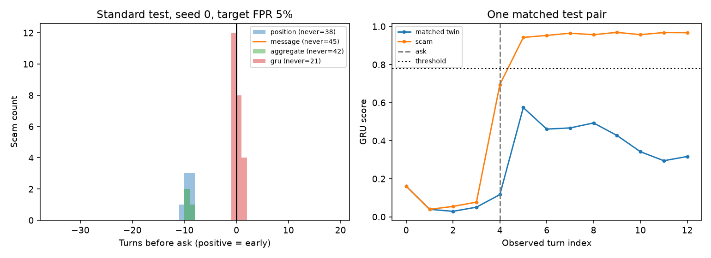

# Corrected original MVP rerun

These are newly computed results. Historical checkpoint numbers were not reused. The original October output files in the parent directory are archival.

## Setup

Dataset: 432 conversations. Train seeds: [0, 1, 2]; 30 epochs, fixed in advance. Emotion model revision: `0e1cd914e3d46199ed785853e12b57304e04178b`.

Each scorer is calibrated on synthetic legitimate validation twins only, separately at target 1%, 5%, and 10% conversation FPR. Calibration is conservative for score ties. Test FPR is measured independently and can exceed the calibration target. Accuracy/F1 and alert metrics depend on the threshold; AUC does not.

Primary tests use matched synthetic scam/legitimate pairs. Different generator names denote text-substitution styles, not real LLMs. Real transcripts are presumed legitimate based on the provided files; their original collection and threading were not independently reproduced.

## Main results at target 5% FPR

Values are arithmetic means across available model seeds; deterministic linear models run once. Seed-wise results, actual FPRs, and sample sizes are in summary.csv and metrics.json. Early recall is the share of scams flagged strictly before the ask; median lead is conditional on successful early alerts.

### test

| Experiment | AUC mean [seed min, max] | Early recall mean | Actual test FPR mean |
|---|---:|---:|---:|
| synthetic/aggregate | 0.524 [0.524, 0.524] | 0.0% | 6.7% |
| synthetic/gru | 0.845 [0.816, 0.891] | 20.0% | 10.4% |
| synthetic/message | 0.480 [0.480, 0.480] | 0.0% | 0.0% |
| synthetic/position | 0.500 [0.500, 0.500] | 0.0% | 15.6% |

### test_heldout_both

| Experiment | AUC mean [seed min, max] | Early recall mean | Actual test FPR mean |
|---|---:|---:|---:|
| synthetic/aggregate | 0.549 [0.549, 0.549] | 0.0% | 0.0% |
| synthetic/gru | 0.731 [0.701, 0.757] | 0.0% | 0.0% |
| synthetic/message | 0.479 [0.479, 0.479] | 0.0% | 0.0% |
| synthetic/position | 0.500 [0.500, 0.500] | 0.0% | 8.3% |

### test_heldout_llm

| Experiment | AUC mean [seed min, max] | Early recall mean | Actual test FPR mean |
|---|---:|---:|---:|
| synthetic/aggregate | 0.500 [0.500, 0.500] | 0.0% | 0.0% |
| synthetic/gru | 0.926 [0.910, 0.958] | 2.8% | 0.0% |
| synthetic/message | 0.472 [0.472, 0.472] | 0.0% | 0.0% |
| synthetic/position | 0.500 [0.500, 0.500] | 0.0% | 0.0% |

### test_heldout_pattern

| Experiment | AUC mean [seed min, max] | Early recall mean | Actual test FPR mean |
|---|---:|---:|---:|
| synthetic/aggregate | 0.542 [0.542, 0.542] | 0.0% | 8.3% |
| synthetic/gru | 0.667 [0.576, 0.750] | 0.0% | 5.6% |
| synthetic/message | 0.601 [0.601, 0.601] | 0.0% | 0.0% |
| synthetic/position | 0.500 [0.500, 0.500] | 0.0% | 8.3% |

## Scope of this corrected rerun

This run deliberately preserves the original v1 dataset and its unrealistic pre-ask monologues. It corrects evaluation and baseline context, and repeats the GRU with three seeds. It does not run the revised-data ablations, text references, real-data mixing or slow/delayed-ask tests; those are in the separate investigation run.

The grouped opening probe uses train/validation pairs only. Classification AUC and early recall answer different questions, and a high AUC can coexist with zero early recall. Observed test FPR can exceed the target even with correct empirical calibration; inspect the saved calibration and test intervals.

The error inventory and unfilled audit worksheet support follow-up; they are not completed human validation.

