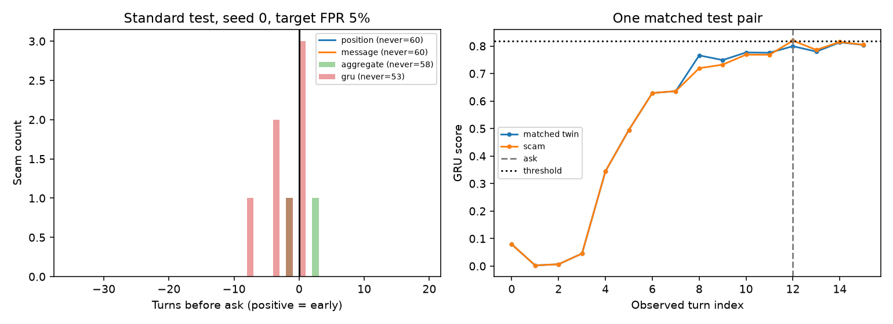

# Rebuilt investigation and iteration checkpoint

These are newly computed results. Historical checkpoint numbers were not reused. The original October output files in the parent directory are archival.

## Setup

Dataset: 1427 conversations. Train seeds: [0, 1, 2]; 30 epochs, fixed in advance. Emotion model revision: `0e1cd914e3d46199ed785853e12b57304e04178b`.

Each scorer is calibrated on synthetic legitimate validation twins only, separately at target 1%, 5%, and 10% conversation FPR. Calibration is conservative for score ties. Test FPR is measured independently and can exceed the calibration target. Accuracy/F1 and alert metrics depend on the threshold; AUC does not.

Primary tests use matched synthetic scam/legitimate pairs. Different generator names denote text-substitution styles, not real LLMs. Real transcripts are presumed legitimate based on the provided files; their original collection and threading were not independently reproduced.

## Main results at target 5% FPR

Values are arithmetic means across available model seeds; deterministic linear models run once. Seed-wise results, actual FPRs, and sample sizes are in summary.csv and metrics.json. Early recall is the share of scams flagged strictly before the ask; median lead is conditional on successful early alerts.

### test

| Experiment | AUC mean [seed min, max] | Early recall mean | Actual test FPR mean |
|---|---:|---:|---:|
| ablation/delta-speaker | 0.505 [0.504, 0.507] | 0.0% | 13.9% |
| ablation/emotion-only | 0.523 [0.521, 0.527] | 0.0% | 5.6% |
| ablation/logistic-delta-speaker | 0.473 [0.473, 0.473] | 0.0% | 3.3% |
| ablation/logistic-emotion-only | 0.448 [0.448, 0.448] | 0.0% | 0.0% |
| ablation/logistic-full | 0.466 [0.466, 0.466] | 0.0% | 3.3% |
| ablation/logistic-no-delta | 0.448 [0.448, 0.448] | 0.0% | 0.0% |
| ablation/logistic-no-speaker | 0.466 [0.466, 0.466] | 0.0% | 3.3% |
| ablation/no-delta | 0.523 [0.522, 0.524] | 0.0% | 6.1% |
| ablation/no-speaker | 0.571 [0.554, 0.588] | 0.0% | 2.2% |
| investigation/preask-label | 0.559 [0.545, 0.569] | 0.0% | 11.1% |
| investigation/shuffled-prefix | 0.527 [0.524, 0.531] | 0.0% | 13.3% |
| mixed/aggregate | 0.452 [0.452, 0.452] | 0.0% | 5.0% |
| mixed/distilbert-frozen-message | 1.000 [1.000, 1.000] | 0.0% | 0.0% |
| mixed/distilbert-frozen-prefix | 1.000 [1.000, 1.000] | 33.3% | 11.7% |
| mixed/gru | 0.505 [0.478, 0.522] | 0.6% | 4.4% |
| mixed/message | 0.392 [0.392, 0.392] | 0.0% | 0.0% |
| mixed/position | 0.500 [0.500, 0.500] | 0.0% | 0.0% |
| mixed/tfidf-message | 1.000 [1.000, 1.000] | 0.0% | 0.0% |
| mixed/tfidf-prefix | 1.000 [1.000, 1.000] | 70.0% | 1.7% |
| synthetic/aggregate | 0.484 [0.484, 0.484] | 1.7% | 3.3% |
| synthetic/distilbert-frozen-message | 1.000 [1.000, 1.000] | 0.0% | 0.0% |
| synthetic/distilbert-frozen-prefix | 1.000 [1.000, 1.000] | 20.0% | 8.3% |
| synthetic/gru | 0.557 [0.536, 0.576] | 0.0% | 8.9% |
| synthetic/message | 0.448 [0.448, 0.448] | 0.0% | 0.0% |
| synthetic/position | 0.500 [0.500, 0.500] | 0.0% | 0.0% |
| synthetic/tfidf-message | 1.000 [1.000, 1.000] | 0.0% | 0.0% |
| synthetic/tfidf-prefix | 1.000 [1.000, 1.000] | 81.7% | 5.0% |

### test_heldout_both

| Experiment | AUC mean [seed min, max] | Early recall mean | Actual test FPR mean |
|---|---:|---:|---:|
| ablation/delta-speaker | 0.499 [0.495, 0.505] | 0.0% | 4.2% |
| ablation/emotion-only | 0.502 [0.500, 0.505] | 0.0% | 8.3% |
| ablation/logistic-delta-speaker | 0.531 [0.531, 0.531] | 0.0% | 0.0% |
| ablation/logistic-emotion-only | 0.471 [0.471, 0.471] | 0.0% | 0.0% |
| ablation/logistic-full | 0.496 [0.496, 0.496] | 0.0% | 0.0% |
| ablation/logistic-no-delta | 0.471 [0.471, 0.471] | 0.0% | 0.0% |
| ablation/logistic-no-speaker | 0.507 [0.507, 0.507] | 0.0% | 0.0% |
| ablation/no-delta | 0.499 [0.497, 0.500] | 0.0% | 5.6% |
| ablation/no-speaker | 0.510 [0.500, 0.517] | 0.0% | 0.0% |
| investigation/preask-label | 0.511 [0.507, 0.517] | 0.0% | 5.6% |
| investigation/shuffled-prefix | 0.507 [0.502, 0.516] | 0.0% | 4.2% |
| mixed/aggregate | 0.534 [0.534, 0.534] | 0.0% | 0.0% |
| mixed/distilbert-frozen-message | 1.000 [1.000, 1.000] | 0.0% | 0.0% |
| mixed/distilbert-frozen-prefix | 0.628 [0.628, 0.628] | 50.0% | 50.0% |
| mixed/gru | 0.549 [0.533, 0.561] | 0.0% | 1.4% |
| mixed/message | 0.471 [0.471, 0.471] | 0.0% | 0.0% |
| mixed/position | 0.500 [0.500, 0.500] | 0.0% | 0.0% |
| mixed/tfidf-message | 0.508 [0.508, 0.508] | 8.3% | 54.2% |
| mixed/tfidf-prefix | 1.000 [1.000, 1.000] | 4.2% | 4.2% |
| synthetic/aggregate | 0.524 [0.524, 0.524] | 0.0% | 0.0% |
| synthetic/distilbert-frozen-message | 1.000 [1.000, 1.000] | 20.8% | 70.8% |
| synthetic/distilbert-frozen-prefix | 0.614 [0.614, 0.614] | 50.0% | 62.5% |
| synthetic/gru | 0.503 [0.502, 0.505] | 0.0% | 2.8% |
| synthetic/message | 0.471 [0.471, 0.471] | 0.0% | 0.0% |
| synthetic/position | 0.500 [0.500, 0.500] | 0.0% | 0.0% |
| synthetic/tfidf-message | 1.000 [1.000, 1.000] | 8.3% | 54.2% |
| synthetic/tfidf-prefix | 1.000 [1.000, 1.000] | 45.8% | 83.3% |

### test_heldout_pattern

| Experiment | AUC mean [seed min, max] | Early recall mean | Actual test FPR mean |
|---|---:|---:|---:|
| ablation/delta-speaker | 0.496 [0.492, 0.498] | 0.0% | 9.7% |
| ablation/emotion-only | 0.510 [0.505, 0.519] | 0.0% | 25.0% |
| ablation/logistic-delta-speaker | 0.503 [0.503, 0.503] | 0.0% | 0.0% |
| ablation/logistic-emotion-only | 0.452 [0.452, 0.452] | 0.0% | 0.0% |
| ablation/logistic-full | 0.516 [0.516, 0.516] | 8.3% | 16.7% |
| ablation/logistic-no-delta | 0.452 [0.452, 0.452] | 0.0% | 0.0% |
| ablation/logistic-no-speaker | 0.516 [0.516, 0.516] | 8.3% | 16.7% |
| ablation/no-delta | 0.514 [0.510, 0.517] | 0.0% | 22.2% |
| ablation/no-speaker | 0.510 [0.493, 0.519] | 0.0% | 5.6% |
| investigation/preask-label | 0.520 [0.517, 0.523] | 0.0% | 20.8% |
| investigation/shuffled-prefix | 0.506 [0.503, 0.510] | 0.0% | 18.1% |
| mixed/aggregate | 0.537 [0.537, 0.537] | 25.0% | 41.7% |
| mixed/distilbert-frozen-message | 1.000 [1.000, 1.000] | 0.0% | 0.0% |
| mixed/distilbert-frozen-prefix | 0.639 [0.639, 0.639] | 29.2% | 70.8% |
| mixed/gru | 0.526 [0.521, 0.531] | 0.0% | 6.9% |
| mixed/message | 0.452 [0.452, 0.452] | 0.0% | 0.0% |
| mixed/position | 0.500 [0.500, 0.500] | 0.0% | 0.0% |
| mixed/tfidf-message | 0.500 [0.500, 0.500] | 0.0% | 0.0% |
| mixed/tfidf-prefix | 1.000 [1.000, 1.000] | 16.7% | 41.7% |
| synthetic/aggregate | 0.529 [0.529, 0.529] | 25.0% | 29.2% |
| synthetic/distilbert-frozen-message | 1.000 [1.000, 1.000] | 0.0% | 0.0% |
| synthetic/distilbert-frozen-prefix | 0.625 [0.625, 0.625] | 29.2% | 62.5% |
| synthetic/gru | 0.513 [0.502, 0.528] | 0.0% | 9.7% |
| synthetic/message | 0.452 [0.452, 0.452] | 0.0% | 0.0% |
| synthetic/position | 0.500 [0.500, 0.500] | 0.0% | 0.0% |
| synthetic/tfidf-message | 1.000 [1.000, 1.000] | 0.0% | 0.0% |
| synthetic/tfidf-prefix | 1.000 [1.000, 1.000] | 41.7% | 100.0% |

### test_heldout_style

| Experiment | AUC mean [seed min, max] | Early recall mean | Actual test FPR mean |
|---|---:|---:|---:|
| ablation/delta-speaker | 0.511 [0.507, 0.514] | 0.0% | 8.3% |
| ablation/emotion-only | 0.513 [0.507, 0.517] | 0.0% | 4.2% |
| ablation/logistic-delta-speaker | 0.500 [0.500, 0.500] | 0.0% | 0.0% |
| ablation/logistic-emotion-only | 0.396 [0.396, 0.396] | 0.0% | 0.0% |
| ablation/logistic-full | 0.456 [0.456, 0.456] | 0.0% | 0.0% |
| ablation/logistic-no-delta | 0.388 [0.388, 0.388] | 0.0% | 0.0% |
| ablation/logistic-no-speaker | 0.456 [0.456, 0.456] | 0.0% | 0.0% |
| ablation/no-delta | 0.515 [0.512, 0.517] | 0.0% | 0.0% |
| ablation/no-speaker | 0.530 [0.516, 0.542] | 0.0% | 0.0% |
| investigation/preask-label | 0.530 [0.516, 0.540] | 0.0% | 4.2% |
| investigation/shuffled-prefix | 0.503 [0.495, 0.510] | 0.0% | 5.6% |
| mixed/aggregate | 0.415 [0.415, 0.415] | 0.0% | 0.0% |
| mixed/distilbert-frozen-message | 1.000 [1.000, 1.000] | 0.0% | 0.0% |
| mixed/distilbert-frozen-prefix | 1.000 [1.000, 1.000] | 0.0% | 0.0% |
| mixed/gru | 0.472 [0.460, 0.488] | 0.0% | 0.0% |
| mixed/message | 0.386 [0.386, 0.386] | 0.0% | 0.0% |
| mixed/position | 0.500 [0.500, 0.500] | 0.0% | 0.0% |
| mixed/tfidf-message | 1.000 [1.000, 1.000] | 12.5% | 54.2% |
| mixed/tfidf-prefix | 1.000 [1.000, 1.000] | 41.7% | 0.0% |
| synthetic/aggregate | 0.437 [0.437, 0.437] | 0.0% | 0.0% |
| synthetic/distilbert-frozen-message | 1.000 [1.000, 1.000] | 25.0% | 83.3% |
| synthetic/distilbert-frozen-prefix | 1.000 [1.000, 1.000] | 16.7% | 16.7% |
| synthetic/gru | 0.527 [0.523, 0.535] | 0.0% | 2.8% |
| synthetic/message | 0.388 [0.388, 0.388] | 0.0% | 0.0% |
| synthetic/position | 0.500 [0.500, 0.500] | 0.0% | 0.0% |
| synthetic/tfidf-message | 1.000 [1.000, 1.000] | 12.5% | 54.2% |
| synthetic/tfidf-prefix | 1.000 [1.000, 1.000] | 83.3% | 4.2% |

### test_slow

| Experiment | AUC mean [seed min, max] | Early recall mean | Actual test FPR mean |
|---|---:|---:|---:|
| ablation/delta-speaker | 0.482 [0.473, 0.488] | 63.9% | 92.8% |
| ablation/emotion-only | 0.591 [0.554, 0.617] | 78.9% | 98.9% |
| ablation/logistic-delta-speaker | 0.600 [0.600, 0.600] | 5.0% | 3.3% |
| ablation/logistic-emotion-only | 0.499 [0.499, 0.499] | 0.0% | 0.0% |
| ablation/logistic-full | 0.484 [0.484, 0.484] | 5.0% | 6.7% |
| ablation/logistic-no-delta | 0.499 [0.499, 0.499] | 0.0% | 0.0% |
| ablation/logistic-no-speaker | 0.482 [0.482, 0.482] | 5.0% | 6.7% |
| ablation/no-delta | 0.569 [0.562, 0.579] | 77.8% | 100.0% |
| ablation/no-speaker | 0.643 [0.554, 0.710] | 40.6% | 60.6% |
| investigation/preask-label | 0.615 [0.588, 0.653] | 76.7% | 91.1% |
| investigation/shuffled-prefix | 0.512 [0.444, 0.555] | 55.6% | 89.4% |
| mixed/aggregate | 0.460 [0.460, 0.460] | 10.0% | 10.0% |
| mixed/distilbert-frozen-message | 1.000 [1.000, 1.000] | 0.0% | 0.0% |
| mixed/distilbert-frozen-prefix | 1.000 [1.000, 1.000] | 95.0% | 86.7% |
| mixed/gru | 0.492 [0.481, 0.513] | 33.3% | 51.1% |
| mixed/message | 0.414 [0.414, 0.414] | 0.0% | 0.0% |
| mixed/position | 0.500 [0.500, 0.500] | 71.7% | 100.0% |
| mixed/tfidf-message | 1.000 [1.000, 1.000] | 0.0% | 0.0% |
| mixed/tfidf-prefix | 1.000 [1.000, 1.000] | 100.0% | 83.3% |
| synthetic/aggregate | 0.486 [0.486, 0.486] | 8.3% | 5.0% |
| synthetic/distilbert-frozen-message | 1.000 [1.000, 1.000] | 0.0% | 0.0% |
| synthetic/distilbert-frozen-prefix | 1.000 [1.000, 1.000] | 93.3% | 80.0% |
| synthetic/gru | 0.595 [0.559, 0.621] | 51.7% | 82.2% |
| synthetic/message | 0.499 [0.499, 0.499] | 0.0% | 0.0% |
| synthetic/position | 0.500 [0.500, 0.500] | 71.7% | 100.0% |
| synthetic/tfidf-message | 1.000 [1.000, 1.000] | 0.0% | 0.0% |
| synthetic/tfidf-prefix | 1.000 [1.000, 1.000] | 100.0% | 90.0% |

## Long / delayed-ask stress test

test_slow reuses only standard-test scenarios, with 20-32 turns and asks at 70-95% of the transcript. Its legitimate twins have the same length, speaker pattern and request position. This adds neutral setup before the pressure turns; it tests length/delayed timing and is not a validated simulation of subtle or adaptive evasion.

## Independent real Enron false-positive check

These held-out examples were excluded from training and calibration. Exact full-transcript duplicates were removed before splitting; near-duplicates and related threads may remain. Rates below are observed on the available sample and do not establish deployment safety.

| Experiment | Target | Enron FPR mean |
|---|---:|---:|
| mixed/aggregate | 5% | 5.0% |
| mixed/aggregate | 10% | 5.5% |
| mixed/distilbert-frozen-message | 5% | 0.0% |
| mixed/distilbert-frozen-message | 10% | 0.0% |
| mixed/distilbert-frozen-prefix | 5% | 6.0% |
| mixed/distilbert-frozen-prefix | 10% | 6.0% |
| mixed/gru | 5% | 0.0% |
| mixed/gru | 10% | 0.0% |
| mixed/message | 5% | 0.0% |
| mixed/message | 10% | 0.0% |
| mixed/position | 5% | 0.0% |
| mixed/position | 10% | 0.0% |
| mixed/tfidf-message | 5% | 0.0% |
| mixed/tfidf-message | 10% | 0.0% |
| mixed/tfidf-prefix | 5% | 0.0% |
| mixed/tfidf-prefix | 10% | 0.0% |
| synthetic/aggregate | 5% | 14.0% |
| synthetic/aggregate | 10% | 14.0% |
| synthetic/distilbert-frozen-message | 5% | 8.0% |
| synthetic/distilbert-frozen-message | 10% | 8.0% |
| synthetic/distilbert-frozen-prefix | 5% | 36.0% |
| synthetic/distilbert-frozen-prefix | 10% | 37.5% |
| synthetic/gru | 5% | 0.3% |
| synthetic/gru | 10% | 0.3% |
| synthetic/message | 5% | 1.0% |
| synthetic/message | 10% | 1.0% |
| synthetic/position | 5% | 0.0% |
| synthetic/position | 10% | 0.0% |
| synthetic/tfidf-message | 5% | 0.5% |
| synthetic/tfidf-message | 10% | 0.5% |
| synthetic/tfidf-prefix | 5% | 68.5% |
| synthetic/tfidf-prefix | 10% | 80.5% |

Wilson intervals and sample counts for each fitted model are saved in metrics.json.

## Shortcut diagnostics

```json
{
  "length_synthetic": {
    "synthetic_test": {
      "auc": 0.6198611111111112,
      "n": 120
    },
    "synthetic_scams_vs_enron": {
      "auc": 0.97275,
      "n": 260
    }
  },
  "length_mixed": {
    "synthetic_test": {
      "auc": 0.6215277777777778,
      "n": 120
    },
    "synthetic_scams_vs_enron": {
      "auc": 0.9823333333333333,
      "n": 260
    }
  },
  "style_synthetic": {
    "synthetic_test": {
      "auc": 1.0,
      "n": 120
    },
    "synthetic_scams_vs_enron": {
      "auc": 0.992,
      "n": 260
    }
  },
  "style_mixed": {
    "synthetic_test": {
      "auc": 1.0,
      "n": 120
    },
    "synthetic_scams_vs_enron": {
      "auc": 0.9996666666666667,
      "n": 260
    }
  },
  "legitimate_source_probe": {
    "auc": 0.9863013698630138,
    "n": 133,
    "caveat": "Separates human/domain from template/domain; does not prove detector reliance on authorship."
  }
}
```

Source style/domain separability is a warning about confounding, not proof that the GRU uses that shortcut. Length features use full transcripts only as an offline diagnostic; the operational position scorer uses observed absolute turn index only.

## Paired uncertainty checks

paired_bootstrap.json contains candidate-minus-GRU differences in AUC and early recall with 95% intervals, resampling matched scenario pairs. These intervals are conditional on seed-0 fits and fixed validation thresholds. The multi-seed tables show additional training variability; neither analysis establishes a population false-positive guarantee.

## Failure analysis and remaining work

The paired ablations investigate feature contribution, while the shuffled-prefix control keeps the current turn fixed and permutes only observed history, recomputing deltas. The pre-ask-label model changes soft training labels only; held-out patterns remain excluded from fit. High end-of-conversation AUC can coexist with zero early recall, so one does not establish or refute the other.

Review error_inventory.json against dataset.json; an inventory is not a completed human error analysis. human_audit_PENDING.csv is an unfilled 150-example worksheet. Human realism ratings, verified ask annotations and inter-rater agreement remain outstanding.

The text references are TF-IDF and frozen pretrained DistilBERT embeddings with logistic classifiers. The prefix DistilBERT reference averages embeddings of observed turns; it does not jointly encode/fine-tune a full transcript. Finite template vocabulary can give high scores; real-LLM generation, Enron restyling, and a fine-tuned DistilBERT ceiling remain uncompleted. Changing generation method alone would not prove that all shortcuts are gone.

The original Enron preparation script is unavailable. Source files are hashed for provenance, but their presumed legitimate labels are not verified. Exact deduplication does not exclude all semantic or related-thread leakage. The primary matched synthetic test and separate real FPR check must both be reported.

All tables above are generated from saved metrics. No historical 40%/56% Enron FPR, 0.78/0.48 slow-burn result, or 1.000 DistilBERT AUC is claimed unless reproduced in these artifacts.



See [FINDINGS.md](FINDINGS.md) for the interpretation used in the rebuilt checkpoint PDF.
